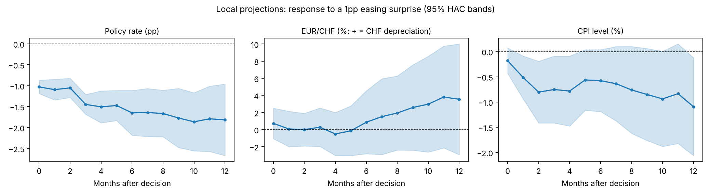

# Monetary Policy Transmission in Switzerland, 2000–2025: A Corrected Replication

*Jan Allemann — revised version of the Master's thesis "Monetary Policy Transmission in Switzerland: Exchange Rate and Inflation Responses to Rate Cuts" (University of Bern). Code: `replication/analysis.py`, `replication/dsge.py`.*

## Abstract

I re-estimate the effects of unexpected SNB policy-rate changes on the EUR/CHF exchange rate and Swiss consumer prices, applying the methods of the original thesis — a purging regression to identify policy surprises, local projections, event studies, a regime split, and a Swiss-calibrated small open economy DSGE model — after correcting several errors.

The original headline results do not survive:

- The reported 4.5% franc depreciation per 1pp cut came from misreading the sign of the shock. With the original specification, the correctly signed estimate is a 4.5% *appreciation*.
- That estimate is driven by a handful of crisis and exchange-rate-floor months.
- The large negative-rate inflation effect was identified from two observations.

With corrected methods:

- An easing surprise has no statistically significant effect on EUR/CHF at any horizon up to 12 months (impact +0.7%, SE 0.9).
- Consumer prices fall after easing surprises (−0.5% to −0.8% after 1–4 months). This is a price puzzle, which indicates that the monthly purging regression does not fully remove the SNB's systematic response to expected disinflation.
- There is no robust evidence of different transmission in the negative-rate regime.
- The corrected DSGE model predicts a 0.3% franc depreciation on impact per 1pp annualised cut. That lies inside the empirical confidence band, but the data cannot distinguish it from zero.

The main lesson is that monthly purging regressions cannot identify Swiss monetary policy surprises precisely enough. High-frequency surprises from interest-rate futures are required.

## 1. Introduction

The SNB cut its policy rate in three episodes between 2000 and 2025 and operated with negative rates from December 2014 to June 2022. The thesis asked two questions:

- How do unexpected cuts affect the franc and inflation?
- Does transmission differ between positive and negative rate regimes?

This paper keeps those questions and the original toolkit, but fixes the implementation (Appendix A lists every change).

## 2. Model

The model is the Galí–Monacelli small open economy New Keynesian model with Swiss calibration:

- β = 0.995, σ = 1.32, openness υ = 0.4, Calvo θ = 0.75
- Interest-rate smoothing ρᵢ = 0.8
- Price indexation γ = 0.25
- Incomplete import-price pass-through (40% per quarter, import share 0.23)
- Exchange-rate leaning in the Taylor rule
- Regime A: φπ = 2.0, φΔe = 0.15. Regime B: φπ = 1.7, φΔe = 0.20.

My Python solution reproduces the thesis impact responses exactly (for example Regime A: π_H 5.3, π 6.8, e 0.298). Two corrections are applied.

**Habit formation.** The original code only scaled the interest elasticity by (1−h). The corrected IS curve is

  y_t = h/(1+h)·y_{t−1} + 1/(1+h)·E_t y_{t+1} − (1−h)/((1+h)σ_υ)·(i_t − E_t π_{H,t+1}).

With this correction the output response becomes hump-shaped, peaking in quarter 2.

**Units.** Model rates are quarterly. The shock in the `.mod` files (0.25) is therefore a 1pp *annualised* innovation, not 25bp. The thesis then multiplied responses by four again. Here every response is normalised to a 1pp fall in the annualised policy rate on impact.

**Table 1. DSGE responses to a 1pp annualised rate cut (corrected habit)**

| | EUR/CHF (%) Q1 / Q2 / Q4 | CPI level (%) Q1 / Q2 / Q4 |
|---|---|---|
| Swiss base | 0.33 / 0.48 / 0.52 | 0.19 / 0.29 / 0.36 |
| Full model, Regime A | 0.32 / 0.48 / 0.54 | 0.10 / 0.21 / 0.36 |
| Full model, Regime B | 0.34 / 0.52 / 0.59 | 0.11 / 0.23 / 0.40 |

The thesis reported about 1.2% depreciation on impact; the correct figure is about 0.3%. Regimes A and B differ by only a few hundredths of a percentage point. The model has no lower bound, so it cannot speak to negative-rate transmission. Bäurle and Kaufmann (2014) show that a binding lower bound substantially amplifies exchange-rate and price responses, which would require an occasionally binding constraint (e.g. OccBin).

## 3. Data and identification

**Data.** The sample is monthly, November 2000 to October 2025 (300 months), and contains 104 SNB decisions: 19 cuts, 15 hikes and 70 holds. Up to June 2019 the policy rate is the midpoint of the 3-month LIBOR target range, and the SNB policy rate thereafter.

- EUR/CHF is the month-end log level. The original code instead used the last trading day's daily return.
- Prices are the log CPI level.

**Purging regression.** The policy-rate change at each meeting is regressed on information available before the meeting:

- lagged CPI inflation
- lagged KOF barometer
- the previous policy rate
- the previous month's EUR/CHF change
- the previous month's change in the 2-year yield
- lagged VIX

All meetings are used, not only cuts, following Romer and Romer (2004). Two decisions announced together with unconventional measures are excluded: 12 March 2009 (start of FX interventions) and 15 January 2015 (floor exit).

The regression uses N = 99 meetings, with R² = 0.34 (adjusted 0.30). The SNB raises rates when past inflation is high (0.088, SE 0.028), and cuts when the rate level is high (−0.084, SE 0.032) and when the VIX is elevated (−0.012, SE 0.005). The residual is the policy shock: positive values are tightening surprises, and the shock is zero in months without a meeting. Its standard deviation is 0.22pp.

**Local projections.** For each horizon h = 0,…,12 months:

  y_{t+h} − y_{t−1} = α + β_h·shock_t + two lags of Δy and of the shock + controls_{t−1} + event dummies + u.

- The event dummies absorb the 2009 intervention, the September 2011 floor introduction and the January 2015 floor exit whenever they fall inside the projection window.
- Standard errors are Newey–West with h+1 lags.
- All responses are reported for a **1pp easing surprise** (−β_h).

## 4. Results

### 4.1 Original specification, correctly signed

The original code reproduces the thesis coefficient exactly: 4.53 (SE 1.47) at h = 1. Because the regressor is the residual from a cuts-only regression, a positive value is a smaller-than-predicted cut. The estimate therefore implies that a 1pp easing surprise *appreciates* the franc by 4.5%.

Removing six months — October–December 2008, August 2011, December 2014 and January 2015 — reduces it to 0.45 (SE 0.94). The h = 1 response for August 2011 is the September 2011 floor introduction. The day-0 event-study effect of 4–5% comes entirely from 15 January 2015.

### 4.2 Baseline local projections

**Table 2. Response to a 1pp easing surprise (SE in parentheses)**

| h (months) | 0 | 1 | 3 | 6 | 12 |
|---|---|---|---|---|---|
| Policy rate (pp) | −1.03 (0.08) | −1.09 (0.13) | −1.45 (0.12) | −1.65 (0.27) | −1.81 (0.44) |
| EUR/CHF (%) | 0.73 (0.91) | 0.08 (1.06) | 0.29 (1.15) | 0.87 (1.88) | 3.54 (3.31) |
| CPI level (%) | −0.18 (0.13) | −0.51 (0.22) | −0.75 (0.34) | −0.58 (0.31) | −1.09 (0.49) |

The shock moves the policy rate one-for-one on impact, and the rate keeps falling afterwards. EUR/CHF point estimates are positive (franc depreciation), as theory predicts, but small and never significant. The 95% band at h = 0, [−1.1, 2.5], contains both zero and the DSGE prediction of 0.3%.

Consumer prices *fall* by 0.5–0.8% within 1–4 months. This is a classic price puzzle, as discussed by Ramey (2016). It means the purged shock still contains the SNB's response to anticipated disinflation. The puzzle is concentrated in the 2008–09 easing:

- Excluding October 2008 to March 2009 shrinks it.
- Using only post-2009 meetings removes it (Table 3).

### 4.3 Event studies

**Daily.** Using all 101 clean meetings and trading-day windows, the response to a 1pp easing surprise is:

| Window | Response (SE) |
|---|---|
| Announcement day | +0.02% (0.26) |
| After 2 days | +0.46% (0.34) |
| After 10 days | +0.28% (0.61) |

There is no pre-trend (days −5 to −1: 0.04, SE 0.62). Including 2009-03-12 and 2015-01-15 flips the day-0 sign, which illustrates how strongly those two events dominate.

**Hourly.** The timestamps of the hourly data are in Sydney local time. Aligned correctly to the 09:30 Zurich announcement, the cleanest SNB surprises move the franc in the textbook direction:

| Date | Decision | EUR/CHF, 09:00–11:00 |
|---|---|---|
| 16 June 2022 | Surprise 50bp hike | −1.8% (franc appreciates) |
| 21 September 2023 | Unexpected hold | +0.9% |
| 21 March 2024 | Surprise 25bp cut | +0.9% |

Regressing these two-hour returns on the *actual* rate change across 25 meetings since 2020 gives nothing (0.12, SE 0.82). Actual changes are a poor proxy for surprises, which is exactly why futures-based measures are needed.

### 4.4 Regimes

Interacting the shock with a negative-rate dummy (31 meetings, only one rate change) gives:

- **EUR/CHF:** no significant difference at any horizon (Wald p between 0.16 and 0.87).
- **CPI:** the two regimes differ at h = 3 and h = 6 (p = 0.036 and 0.001). The negative-regime "shocks" are, however, residuals at hold meetings with almost no variation in the rate (SD 0.14), so this is weak evidence. It does not support the original claim of a +5.8pp inflation effect, which was identified from two observations and had the wrong sign.

### 4.5 Robustness

**Table 3. Robustness: response to a 1pp easing surprise at h = 0 / 3 / 12**

| Specification | EUR/CHF (%) | CPI level (%) |
|---|---|---|
| Baseline | 0.73 / 0.29 / 3.54 | −0.18 / −0.75 / −1.09 |
| No event-window dummies | 0.63 / −0.99 / 2.03 | −0.18 / −0.77 / −1.30 |
| Excl. GFC easing (Oct 2008–Mar 2009) | 0.08 / −0.01 / 1.78 | −0.08 / −0.46 / −1.08 |
| Raw rate change as shock | 0.42 / −0.13 / 3.60 | −0.13 / −0.74 / −0.89 |
| Post-2009 meetings only | 1.63 / 1.44 / 4.52 | −0.16 / −0.15 / −0.47 |

No EUR/CHF estimate in Table 3 is significant at 5%.

## 5. Model versus data

| | DSGE (Regime A) | Data |
|---|---|---|
| EUR/CHF on impact, per 1pp cut | +0.32% | +0.73% (SE 0.91) |
| CPI level after one year | +0.36% | −1.09% (SE 0.49) |

The model and data agree on the direction of the exchange-rate response. However, the empirical estimate is too imprecise to confirm or reject the model. On prices they disagree. Given the price puzzle, the disagreement more likely reflects identification than a failure of the model.

## 6. Conclusion

Correctly signed and properly identified, the data do not show that SNB rate cuts significantly weaken the franc at monthly frequency, nor that negative rates changed transmission. The DSGE model's predicted effect (about 0.3% per 1pp) is small relative to monthly EUR/CHF volatility, and a purging regression with lagged macro data leaves systematic policy in the shock.

The natural next step is to use high-frequency surprises from CHF interest-rate futures. Borner (2025) constructs them for 114 SNB announcements from 2000 to 2024 and separates information shocks from pure policy shocks. They can be fed into the same local projections, together with a DSGE model that imposes the lower bound.

## Appendix A. Corrections relative to the original thesis code

1. **Shock sign.** The cuts-only residual is positive for smaller-than-predicted cuts, so the reported "+4.53% depreciation per cut" is in fact a −4.53% response to easing.
2. **Monthly EUR/CHF change.** The original used the last day's daily return (January 2015: −0.6% instead of −14.6%). This affected control selection and the causal forest.
3. **Purging sample and controls.** The purging regression now uses all meetings and predetermined controls. Originally it used 19 cuts, adjusted R² < 0, contemporaneous 2-year yield and VIX, and controls chosen by predicting the FX *outcome*. The thesis table (2 controls, R² = 0.098) also did not match the code output (4 controls, R² = 0.214).
4. **Unconventional measures.** The 2009 intervention start, the 2011 floor introduction and the 2015 floor exit are handled explicitly.
5. **Negative regime.** Originally it was identified from 2 shocks (December 2014, January 2015).
6. **Local projections.** h = 0 added, outcome and shock lags added, HAC lags h+1, log CPI level instead of the change in year-on-year inflation.
7. **Event studies.** Trading-day instead of calendar-day indexing. The hourly study was empty in the original: the bars are on the hour and the announcement is at 09:30, so no observation matched. The timestamps are also in Australia/Sydney time.
8. **DSGE.** Habit IS curve corrected; shock units (0.25 = 1pp annualised) and the ×4 rescaling fixed; quarterly model responses no longer compared directly with monthly horizons.

## References

- Bäurle, G. and D. Kaufmann (2014). Exchange rate and price dynamics in a small open economy – the role of the zero lower bound and monetary policy regimes. SNB Working Paper 2014-10.
- Borner, D. (2025). Central bank information and pure monetary policy surprises in Switzerland. SNB Working Paper 2025-01.
- Fink, F., L. Frei, T. Maag and T. Zehnder (2024). The impact of SNB monetary policy on the Swiss franc and longer-term interest rates. *International Journal of Central Banking* 20(1).
- Galí, J. and T. Monacelli (2005). Monetary policy and exchange rate volatility in a small open economy. *Review of Economic Studies* 72(3).
- Jordà, Ò. (2005). Estimation and inference of impulse responses by local projections. *American Economic Review* 95(1).
- Montiel Olea, J. L. and M. Plagborg-Møller (2021). Local projection inference is simpler and more robust than you think. *Econometrica* 89(4).
- Ramey, V. A. (2016). Macroeconomic shocks and their propagation. *Handbook of Macroeconomics* 2.
- Romer, C. D. and D. H. Romer (2004). A new measure of monetary shocks: derivation and implications. *American Economic Review* 94(4).
